<!--
  Profile README for github.com/LuizFps120hz
  Content mirrors the portfolio (claudius/portfolio/src/data/profile.ts).
  Accent: phosphor green #3dff9a on #0d1117, same as the portfolio.
-->

<div align="center">

<a href="https://luizfps120hz.github.io">
   hi, I'm Luiz Felipe" />
</a>

<a href="https://luizfps120hz.github.io"></a>


</div>

```console
lfps@debian:~$ whoami
name       : Luiz Felipe (lfps)
role       : Software Development Student
studying   : Systems Analysis & Development @ Facimp Wyden
location   : Brazil
interests  : linux & security · backend · automation & AI tools · self-hosting

lfps@debian:~$ cat now.txt
Leveling up in backend development, databases, automation and cloud.
Looking for remote internships and entry-level roles.
```

### `$ ls ~/stack`

<p>
<code>languages</code><br />


<br /><br />
<code>web</code><br />


<br /><br />
<code>backend</code><br />


<br /><br />
<code>infra</code><br />


</p>

### `$ ls ~/projects --featured`

| project | what it does | stack | where |
| :-- | :-- | :-- | :-- |
| **[wynnbuilder](https://github.com/LuizFps120hz/wynnbuilder)** | Gear optimizer for Wynncraft: searches item combinations, validates skill points and ranks the best builds. Static, runs in the browser. | JavaScript | [repo](https://github.com/LuizFps120hz/wynnbuilder) · [live](https://luizfps120hz.github.io/wynnbuilder/) |
| **caixa-web** | Personal finance hub: balance, upcoming payments, a bill calendar and projections in one place. React frontend + separate Express API. | React · Express · PostgreSQL | not public yet |
| **debian-maintenance-tool** | Keeps a Debian machine healthy: system health checks, app management and disk management in one tool. | Debian · Linux | not public yet |
| **home-lab** | Self-hosted web services across several machines at home, behind Nginx and reachable over Tailscale. | Docker · Nginx · Tailscale | ongoing |
| **portfolio** | My personal site: terminal aesthetic, strict CSP, zero trackers. | Astro · Tailwind · TypeScript | [luizfps120hz.github.io](https://luizfps120hz.github.io) |

### `$ git log --stats`

<div align="center">
  
  
  <br />
  
</div>

<div align="center">
  <picture>
    <source media="(prefers-color-scheme: dark)" srcset="https://raw.githubusercontent.com/LuizFps120hz/LuizFps120hz/output/snake-dark.svg" />
    <source media="(prefers-color-scheme: light)" srcset="https://raw.githubusercontent.com/LuizFps120hz/LuizFps120hz/output/snake-light.svg" />
    
  </picture>
</div>

### `$ ./contact.sh`

<p>
  <a href="https://luizfps120hz.github.io"></a>
  <a href="https://github.com/LuizFps120hz"></a>
  <!-- Add more when ready (same style):
  <a href="https://www.linkedin.com/in/YOUR-HANDLE"></a>
  <a href="mailto:YOUR-EMAIL"></a>
  -->
</p>

<div align="center">
  <sub><code>lfps@debian:~$ exit</code> · thanks for stopping by</sub>
</div>
